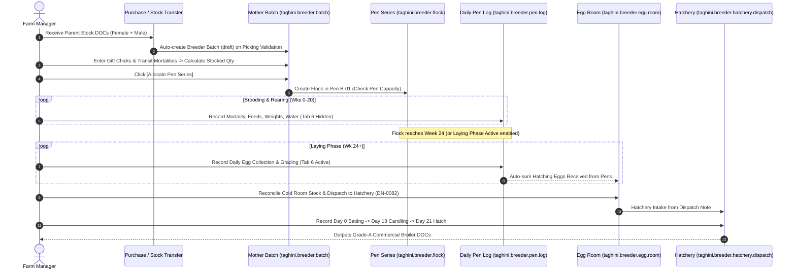

# Taghini Farm Management Module Guide (v1.6.2)
*Odoo 19.0 Enterprise / Community*

This comprehensive guide documents the architecture, data models, master record setup, business workflows, operational controls, and testing scenarios for the `chicken_farm_module`.

---

## 1. Module Overview & Purpose

The Taghini Farm Management module is a closed-loop enterprise poultry production system supporting two specialized workflows:
1. **Commercial Broiler Workflow:** Manages day-old broiler chick intake, house stocking density, daily mortality/feed/weight tracking against breed curves (Ross 308), harvesting, and automated abattoir yield accounting.
2. **Parent Stock Breeder Workflow (Arbor Acres Plus):** Implements a strict 3-tier parent stock hierarchy, multi-pen allocation with capacity guards, automated stage progression (brooding, rearing, mating, laying), controlled-visibility egg collection, cold-room reconciliation, and hatchery candling/breakout/hatching analytics.

---

## 2. Master Records Setup (Pre-requisites)

Before initiating operational batches, the following foundational master records must be configured in Odoo:

### 2.1 Farms (`taghini.farm`)
**Menu:** `Taghini Farm > Configuration > Farms`
* **Breeder Farm Site:** Set `farm_type = 'breeder'` and link to a dedicated breeding warehouse (`WH/BREED`).
* **Commercial Broiler Site:** Set `farm_type = 'broiler'` and link to a commercial broiler warehouse (`WH/BROIL`).

### 2.2 Pens & Accommodation Limits (`taghini.pen`)
**Menu:** `Taghini Farm > Configuration > Pens`
Every house or pen must define its physical dimensions and biological stocking limit:
* `name`: Pen code (e.g. `Pen B-01`, `Pen B-02`, `Pen C-01`).
* `farm_id`: The parent farm site.
* `length` & `width`: House dimensions in meters.
* `usable_area`: Computed surface area in square meters ($m^2$).
* `capacity`: **Maximum allowable birds** that can be safely housed under biosecurity and animal welfare guidelines.
* `stocking_density`: Auto-computed as $\text{capacity} / \text{usable\_area}$ ($\text{birds}/m^2$).
* `location_id`: Internal stock location representing the pen floor.

| Pen Code | Farm Site | Usable Area ($m^2$) | Capacity (Birds) | Target Stocking Density |
| :--- | :--- | :--- | :--- | :--- |
| **Pen B-01** | Breeder Site Alpha | $960\text{ m}^2$ | **5,500** | $\approx 5.73\text{ birds/m}^2$ |
| **Pen B-02** | Breeder Site Alpha | $1,050\text{ m}^2$ | **6,000** | $\approx 5.71\text{ birds/m}^2$ |
| **Pen C-01** | Commercial Broiler Farm 1 | $1,400\text{ m}^2$ | **20,000** | $\approx 14.29\text{ birds/m}^2$ |

### 2.3 Breed Performance Standards (`taghini.farm.standard`)
**Menu:** `Taghini Farm > Configuration > Performance Standards`
Defines standard breed targets and weekly feeding/growth profiles:
1. **Commercial Broiler Standard:** (e.g., *Ross 308 Broiler Standard*)
   * Target curves for daily feed intake (Starter: Days 0–10, Grower: Days 11–24, Finisher: Day 25+).
   * Daily expected body weight (g), daily mortality %, and target FCR.
2. **Parent Stock Breeder Standard:** (e.g., *Arbor Acres Plus Parent Stock Standard 2024*)
   * Target curves across 64 weeks: female & male body weight targets, lighting hours, weekly mortality thresholds, feed allocation (g/bird), hen-day production %, and hatchability %.

### 2.4 Product Catalog Classification (`product.template`)
**Menu:** `Inventory > Products > Products` *(or `Purchase > Products`)*
Live birds, feeds, medications, eggs, and processed meats are standard Odoo products extended with poultry metadata (located under the **General Information** tab next to Product Category):

| Product SKU / Name | Type | Bird Variant | Bird Workflow (`bird_flow`) | Sex (`bird_sex`) | Purchase OK | Sale OK | Notes |
| :--- | :---: | :---: | :--- | :--- | :---: | :---: | :--- |
| **Arbor Acres PS Female DOC** | Storable | `[x]` On | `Breeder Stock` | `Female` | `[x]` | `[ ]` | Parent stock female day-old chicks |
| **Arbor Acres PS Male DOC** | Storable | `[x]` On | `Breeder Stock` | `Male` | `[x]` | `[ ]` | Parent stock male day-old cockerels |
| **Ross 308 Broiler DOC** | Storable | `[x]` On | `Commercial Broiler` | `Both Sexes` | `[x]` | `[ ]` | Commercial broiler day-old chicks |
| **Breeder Starter / Grower / Layer Feed** | Storable | `[ ]` Off | — | — | `[x]` | `[ ]` | 25 kg bags with target feeding specs |
| **Broiler Starter / Grower / Finisher** | Storable | `[ ]` Off | — | — | `[x]` | `[ ]` | 25 kg bags for meat birds |
| **Hatching Eggs (Grade-A)** | Storable | `[ ]` Off | — | — | `[ ]` | `[x]` | Fertile incubation-grade eggs ($\ge 50\text{g}$) |
| **Table / Reject / Cracked Eggs** | Storable | `[ ]` Off | — | — | `[ ]` | `[x]` | Commercial consumption eggs |
| **Whole Chilled Carcass (Grade A)** | Storable | `[ ]` Off | — | — | `[ ]` | `[x]` | `abattoir_type = 'series'` |

---

## 3. Data Models Architecture

### 3.1 Strict 3-Tier Breeder Architecture
Legacy implementations that allowed logging daily field operations directly against mother batches have been purged. The breeder architecture strictly separates macro procurement from micro pen operations:

```
Tier 1: Mother Batch (taghini.breeder.batch)
   └── Macro procurement, intake reconciliation, live flock roll-up KPIs
         │
         ├── Tier 2: Pen Series / Breeder Flock (taghini.breeder.flock) [Pen B-01]
         │     └── Physical pen allocation, capacity guard, laying phase flag
         │           │
         │           └── Tier 3: Daily Pen Logs (taghini.breeder.pen.log)
         │                 └── Daily 7-tab operations ledger (mortality, feed, water, eggs)
         │
         └── Tier 2: Pen Series / Breeder Flock (taghini.breeder.flock) [Pen B-02]
               └── ...
```

#### Tier 1 — Breeder Mother Batch (`taghini.breeder.batch`)
*File:* `models/breeder.py`
* **Purpose:** Acts as the primary fiscal and genetic intake umbrella. Holds supplier contracts, ordered quantities, in-transit mortalities, gift chick bonuses, and housing facility setup.
* **Allocation Guard:** Direct daily logging is disabled. Users click **`[ Allocate Pen Series ]`** (`action_create_flock`) to distribute parent stock into physical houses.
* **Live Roll-Up Metrics:** Auto-computes aggregate metrics across all constituent pens: `total_current_females`, `total_current_males`, `total_current_birds`, `total_mortality_female`, `total_mortality_male`, `mortality_rate %`, and `total_eggs_collected`.
* **Actions:**
  * `action_create_flock`: Opens pen allocation form pre-filled with remaining female/male stock.
  * `action_export_111_col_excel`: Generates the complete multi-pen 111-column Excel operations ledger.
  * State progression: `draft` $\rightarrow$ `received` $\rightarrow$ `sorted` $\rightarrow$ `mating` $\rightarrow$ `laying` $\rightarrow$ `harvested` $\rightarrow$ `closed`.

#### Tier 2 — Pen Series / Breeder Flock (`taghini.breeder.flock`)
*File:* `models/breeder_flock.py`
* **Purpose:** Manages parent stock placed in a specific pen house (`pen_id`).
* **Capacity Constraint:** Strictly prevents over-stocking via:
  $$\text{initial\_females} + \text{initial\_males} \le \text{pen\_id.capacity}$$
  *(Enforced via real-time onchange warning modal and hard `@api.constrains` preventing save).*
* **Laying Phase Controller:** Contains the **`laying_started`** (*Laying Phase Active*) toggle. Automatically activates when age reaches 24 weeks or can be manually engaged by the farm manager for early laying (Wks 20–23).
* **Smart Actions:** `[ Log Daily Operations ]` and `[ Export 111-Col Ledger (Excel) ]`.

#### Tier 3 — Daily Pen Operations Ledger (`taghini.breeder.pen.log`)
*File:* `models/breeder_pen_log.py`
* **Purpose:** Daily operational data entry per pen across 7 dedicated tabs:
  1. *Bird Population & Mortality:* Female/male deaths and culls.
  2. *Feed & Nutrition:* Feed product, 25kg bags, feed consumed in grams, gram-per-bird checks.
  3. *Water & Environment:* Water meter, water:feed ratio alerts, house temperatures, litter condition (1–5).
  4. *Body Weight & Uniformity:* Sample weights, CV %, uniformity %, deviation vs Arbor Acres standard curve.
  5. *Lighting & Environment:* Dark-out hours, photoperiod drift tolerance, light intensity (lux).
  6. *Egg Collection & Grading:* **Controlled Visibility.** 100% hidden (`invisible="not is_laying"`) during Brooding (Wks 0–3) and Rearing (Wks 4–20). Reveals automatically at Week 24 or when unlocked on the parent Breeder Flock.
  7. *Medication, Vaccination & Remarks:* Doses, store receipts, vet observations, supervisor sign-off.
* **Automated Audit Flags:** Generates instant `danger_flags` (e.g. daily mortality $>0.03\%$, feed variance $>\pm 3\%$, water fall $>5\%$, water:feed ratio $<1.5$ or $>2.5$).

---

### 3.2 Egg Room & Hatchery Operations

#### Egg Room Stock & Dispatch Ledger (`taghini.breeder.egg.room`)
*File:* `models/breeder_egg_room.py`
* **Purpose:** Bridges farm egg collection and incubator dispatch.
* **Daily Stock Reconciliation:**
  $$\text{Closing Stock} = \text{Opening Stock} + \text{Received from Pens} - \text{Rejected/Broken} - \text{Dispatched to Hatchery}$$
* **Cold Storage & Sanitation:** Captures egg room minimum/maximum temperature ($18.5^\circ\text{C}$), relative humidity ($75\%$), and fumigation verification (`fumigated = True`).
* **Dispatch Control:** Assigns official Dispatch Note No. (`dispatch_note_no`), tracks days since last dispatch (alerting if $>7$ days), and computes transit breakage loss.

#### Hatchery Candling, Breakout & Hatching (`taghini.breeder.hatchery.dispatch`)
*File:* `models/breeder_hatchery.py`
* **Purpose:** Comprehensive hatchery management from setting to day-old chick pull.
* **Incubation Stages:**
  1. *Setting (Day 0):* Setter machine assignment, setting date, `eggs_set`.
  2. *Candling & Breakout (Day 18):* Tracks infertile clears, early dead (0–7 d), mid dead (8–14 d), contaminated/exploders.
  3. *Hatch & Take-Off (Day 21):* Late dead (15–21 d), pipped dead, total chicks hatched, cull chicks, and **Saleable Grade-A Chicks**.
* **Key BI Hatchery Benchmarks:**
  $$\text{Fertility \%} = \frac{\text{Eggs Set} - \text{Infertile Clears}}{\text{Eggs Set}}$$
  $$\text{Hatch of Set \%} = \frac{\text{Saleable Chicks}}{\text{Eggs Set}}$$
  $$\text{Hatch of Fertile \%} = \frac{\text{Saleable Chicks}}{\text{Fertile Eggs}}$$
  *Auto-compares hatch results against flock-age benchmark curves and computes variance in points (`hatch_dev_pts`).*

---

### 3.3 Commercial Broiler Architecture

#### Broiler Mother Batch (`taghini.chicken.batch`)
*File:* `models/batch.py`
* Holds macro procurement of commercial broiler day-old chicks (`Ross 308 Commercial Broiler DOC`).
* Tracks `total_quantity`, `allocated_quantity`, and `remaining_quantity`.
* Auto-generated from internal stock transfers or receipts upon validation.

#### Broiler Flock / Pen (`taghini.flock`)
*File:* `models/flock.py`
* Represents a fattening cycle in a pen house (`pen_model_id`).
* Constrained by `pen_capacity` to prevent over-crowding.
* Links source batch, product, growth profile, daily logs, and harvest records.
* Computes real-time `current_birds`, `mortality_rate %`, and `unrecorded_birds` ($\text{Placed} - \text{Mortality} - \text{Harvested}$).

#### Broiler Daily Operations (`taghini.daily.log`)
*File:* `models/daily_log.py`
* Tracks daily broiler mortality, feed bag usage, water consumption, and sample weights.
* Posts automated inventory scrap records for dead birds and stock deduction for feed consumed upon confirmation (`action_post_log`).

#### Harvest & Abattoir Yield (`taghini.harvest` & `taghini.abattoir.batch`)
*Files:* `models/harvest.py`, `models/abattoir.py`
* Captures crating, farm gate live weight, and dispatch to abattoir.
* Abattoir processing records live arrival weight, hanging duration, scalding temperature, evisceration, and chilling.
* Computes **Eviscerated Carcass Yield %** and posts processed inventory into whole birds, chicken cuts, and residuals.

---

## 4. End-to-End Operational Workflows

### 4.1 Parent Stock Breeder Workflow (Step-by-Step)



1. **Procurement & Transfer:**
   * Create PO for `Arbor Acres PS Female DOC` (10,000 units) and `Arbor Acres PS Male DOC` (1,200 units).
   * Validate Incoming Shipment to `WH/BREED`.
   * `StockPicking._action_done()` instantiates a `taghini.breeder.batch` in `draft`.
2. **Mother Batch Intake:**
   * Open `Taghini Farm > Batches > Breeder Batches`.
   * Standard ratio calculation auto-derives: $\text{male\_order\_qty} = \text{round}(\text{female\_order\_qty} \times 0.12)$.
   * Input gift chicks (`gift_female_qty`, `gift_male_qty`) and transit/arrival mortalities.
   * System calculates final stocked birds:
     $$\text{stocked\_female\_qty} = (\text{female\_order\_qty} + \text{gift\_female\_qty}) - \text{transit\_female\_mortality} - \text{premise\_female\_mortality}$$
   * Advance state: `[Mark Received]` $\rightarrow$ `[Mark Sorted]`.
3. **Pen Series Allocation:**
   * Click `[ Allocate Pen Series ]` from Mother Batch Alpha.
   * **Allocation 1 (Pen B-01):** Select `Pen B-01` (Capacity: 5,500). Enter `4,900` Females and `580` Males (Total = $5,480 \le 5,500$). Save.
   * **Allocation 2 (Pen B-02):** Click `[ Allocate Pen Series ]` again. Select `Pen B-02` (Capacity: 6,000). Enter remaining `5,285` Females and `642` Males (Total = $5,927 \le 6,000$). Save.
   * **Capacity Enforcement:** If an operator attempts to place chicks exceeding the pen's defined accommodation capacity, an onchange warning is displayed in the UI, and saving is strictly blocked by a `@api.constrains` `ValidationError`.
   * **Reconciliation:** All 10,185 Females and 1,222 Males are now allocated (Total = 11,407 chicks). Mother Batch remaining balances reach 0.
4. **Daily Field Operations:**
   * Technicians open Pen Series $\rightarrow$ `[ Log Daily Operations ]`.
   * Weeks 0–20: Brooding/Rearing rations, mortality tracking, weekly body weight vs Arbor Acres profile. Tab 6 (Egg Collection) is invisible.
   * Week 24+: Tab 6 unlocks. Daily egg counts are logged by grade: Hatching Grade-A, Table, Cracks, Double-Yolk, Small ($<50\text{g}$).
5. **Egg Room Dispatch:**
   * Go to `Taghini Farm > Egg Room & Hatchery > Egg Room Stock`.
   * System aggregates all hatching eggs gathered from pen logs.
   * Cold room sorting removes cracked/broken eggs.
   * Enter dispatch quantity and generate Dispatch Note (`DN-2026-11-0082`).
6. **Hatchery Incubation & Hatch:**
   * Go to `Taghini Farm > Egg Room & Hatchery > Hatchery Dispatches`.
   * Log Set Date (Day 0) and setter machine number.
   * Day 18 Candling: Log infertile clears, early dead, exploders.
   * Day 21 Take-Off: Log chicks hatched, cull chicks, and **Saleable Grade-A DOCs**.
   * System computes Fertility %, Hatch % of Set, and benchmark variance points.

---

### 4.2 Commercial Broiler Workflow (Step-by-Step)

1. **Intake & Automated Batch Creation:**
   * Transfer Grade-A saleable DOCs from Hatchery to Commercial Broiler Farm warehouse (`WH/BROIL`).
   * Validating the stock transfer triggers `StockPicking._action_done()`, creating a `taghini.chicken.batch` (`bird_flow == 'broiler'`).
2. **Flock Placement:**
   * Create a `taghini.flock` linked to the source batch.
   * Assign pen (`pen_model_id`). System validates that `quantity_placed` does not violate pen capacity.
   * Link `Ross 308 Broiler Standard`.
3. **Daily Operations:**
   * Technicians log daily mortality, feed bag usage, water consumption, and sample weights.
   * System validates feed type against flock age (Starter Day 0–10, Grower Day 11–24, Finisher Day 25+).
   * Confirming logs creates real-time stock moves and mortality scrap records.
4. **Harvest & Abattoir:**
   * At Day 35–42, initiate `taghini.harvest`. Record birds harvested and live weight.
   * Create `taghini.abattoir.batch`:
     * Verify intake and DOA.
     * Record slaughtering parameters (stunning, scalding, evisceration, blast chilling).
     * Enter output lines (Whole birds, cut-ups, residuals).
     * System computes Eviscerated Carcass Yield % and posts processed products into finished goods stock.

---

## 5. Reporting, Audits & Excel Engine

### 5.1 The 103-Column Excel Ledger Export (111-Column Specification)
Available from any **Breeder Mother Batch** or **Breeder Pen Series** form:
* Click: **`[ Export 111-Col Ledger (Excel) ]`**
* Engine: `wizard/breeder_excel_export_wizard.py` (openpyxl).
* Architecture:
  * **Columns & Layout:** Exports **103 active operational data columns** organized into 10 color-coded sections (commonly referred to on farm as the "111-column operations ledger" referencing the complete technical ledger spec including index keys).
  * **Freeze Panes:** Positioned at cell `E6` (locks Date, Flock Age Days, Flock Age Weeks, and Pen Reference).
  * **Summary Totals:** Formula-based `=SUM(X6:Xn)` for all counts and `=AVERAGE()` for environmental metrics.
  * **10 Color-Coded Header Sections:**
    1. Demographics & Age (Cols 1–4) — *Dark Navy*
    2. Female Mortality & Culls (Cols 5–13) — *Rose Red*
    3. Male Mortality & Culls (Cols 14–22) — *Steel Blue*
    4. Feed Allocation & Nutrition (Cols 23–37) — *Forest Green*
    5. Water Consumption & Metering (Cols 38–47) — *Teal*
    6. Body Weight & Flock Uniformity (Cols 48–60) — *Gold/Orange*
    7. Egg Production & Grading (Cols 61–79) — *Purple*
    8. Egg Room & Dispatch Ledger (Cols 80–91) — *Olive*
    9. Vaccinations & Biosecurity (Cols 92–98) — *Maroon*
    10. Environmental House Climate (Cols 99–103) — *Slate Gray*
  * **Dynamic Threshold Alerts:** Cells are conditionally highlighted (bold red/amber text) when values breach Arbor Acres standards (e.g. daily female mortality $>0.03\%$, feed variance $>\pm 3\%$, water:feed ratio $<1.5$ or $>2.5$).

### 5.2 Business Intelligence (BI) Analytics
Navigate to: **Taghini Farm > Reporting > Breeder Performance Analysis**
* Multi-dimensional `<pivot>` and `<graph>` views:
  * Mortality rate % by pen and housing system (open-sided deep litter vs closed climate).
  * Weekly feed intake (g/bird) vs standard curve.
  * Hen-day egg production % and cumulative eggs per hen housed.
  * Hatchery fertility and hatchability trends over time.

---

## 6. Verification & Quality Assurance Scenarios

### Test Scenario 1: Pen Accommodation Capacity Guard
* **Objective:** Ensure no pen can be over-stocked beyond its biological capacity.
* **Steps:**
  1. Open a Pen with `capacity = 5,000`.
  2. Open Breeder Mother Batch $\rightarrow$ click `[ Allocate Pen Series ]`.
  3. Enter `initial_females = 4,800` and `initial_males = 500` (Total = 5,300).
* **Expected Result:**
  * Real-time warning modal appears indicating total chicks exceed pen capacity.
  * Attempting to save raises a strict `ValidationError: Cannot allocate 5,300 birds to Pen (Capacity: 5,000)`.

### Test Scenario 2: Controlled Egg Collection Visibility
* **Objective:** Ensure egg collection fields cannot distract operators during rearing.
* **Steps:**
  1. Create a Breeder Pen Series with flock age at Week 2 (Brooding).
  2. Open `[ Log Daily Operations ]`.
  3. Check notebook tabs.
* **Expected Result:**
  * Tab 6 (Egg Collection & Grading) is **completely hidden**.
  * Advancing flock age to Week 24 (or toggling `Laying Phase Active` on the Pen Series) causes Tab 6 to become visible immediately.

### Test Scenario 3: Automated Stock Picking Batch Generation
* **Objective:** Verify automated batch creation upon stock picking validation.
* **Steps:**
  1. Create Internal Transfer of `Arbor Acres PS Female DOC` to a Breeder Farm warehouse.
  2. Validate transfer (`_action_done`).
* **Expected Result:**
  * A new `taghini.breeder.batch` is created automatically in `draft` state linked to the picking.
  * Transferred quantity populates `female_order_qty`, and male quantity is auto-calculated at 12%.

### Test Scenario 4: 111-Column Excel Ledger Generation
* **Objective:** Validate openpyxl workbook structure.
* **Steps:**
  1. Open a Breeder Batch with posted pen logs.
  2. Click `[ Export 111-Col Ledger (Excel) ]`.
* **Expected Result:**
  * Browser downloads `.xlsx` file.
  * File opens cleanly in Microsoft Excel / LibreOffice with freeze panes at `E6`, color-coded headers, valid formulas, and Arbor Acres benchmark alert highlighting.
